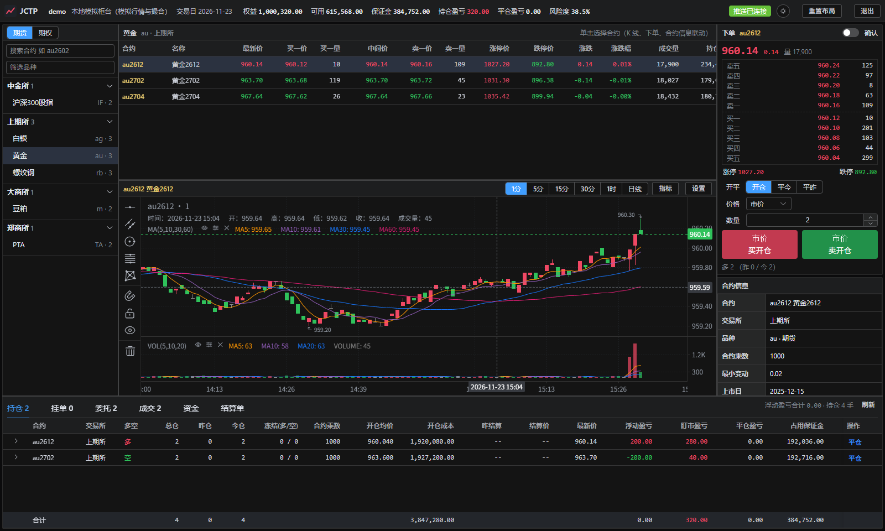

# CTP For Java

用 Java 25 FFM（Foreign Function & Memory API）直接调用 CTP x64 原生库，不经过 JNI/SWIG 包装层。
`core` 提供行情 `CtpMdBroker` 与交易 `CtpTdBroker`；`server` + `web` 在其上实现一个类快期的网页交易终端，
并内置不连 CTP 的本地模拟柜台。



<sub>本地模拟柜台下的主界面（暗夜主题）：左侧品种、上方行情表、中间 K 线与画图工具栏、右侧盘口与下单板、底部持仓等交易数据。</sub>

## 模块

| 模块 | 说明 |
|---|---|
| `core` | CTP 基础库：FFM 绑定（多版本原生库、结构体、虚函数表）+ `CtpMdBroker` / `CtpTdBroker` |
| `server` | 网页端服务（Javalin 7 + Jackson）：会话、合约目录、行情推送（WebSocket）、K 线合成、下单撤单、持仓资金、结算单、本地模拟柜台 |
| `web` | 网页端（Vue 3 + Element Plus + Pinia + KLineChart 10）：行情、K 线（画图、指标、设置）、下单与交易数据 |

## 支持的 CTP 版本

原生库随 `core` 打包（Windows `*.dll`、Linux `*.so`，x64），按需解压加载；**同一进程可同时加载多个版本**，
不同账号可用不同版本登录。

| 版本 | 资源目录 | 说明 |
|---|---|---|
| 6.3.15 | `jctpv6v3v15x64api` | 缺省版本 |
| 6.5.1 | `jctpv6v5v1x64api` | 合约代码类字段扩至 81 字节；行情新增组播合约查询 |
| 6.6.8 | `jctpv6v6v8x64api` | 交易 Api/Spi 新增方法，部分槽位顺延 |
| 6.7.2 / 6.7.2_CP | `jctpv6v7v2x64api` / `jctpv6v7v2CPx64api` | 生产版 / 测评版（穿透式监管认证测试） |
| 6.7.8 / 6.7.8_CP | `jctpv6v7v8x64api` / `jctpv6v7v8CPx64api` | 生产版 / 测评版 |

- 各版本的结构体布局（`CtpStructs`）与 Api/Spi 虚函数表（`CtpVtables`）由该版本随附的头文件生成，调用按方法名查槽位，
  新增版本只需放入原生库与头文件并重新生成。
- 加载时校验原生库自报的版本号，生产版与测评版互不混用。测评版只能连测评环境，连 SimNow 等生产环境无法完成登录。

## core 使用

```java
CtpConfig config = CtpConfig.simnow(CtpConfig.SimNow.GROUP1, "用户代码", "密码").toBuilder()
    .version(CtpVersion.V6_7_8)
    .build();

CtpTdBroker td = new CtpTdBrokerImpl(config);
td.connect();                                   // 连接、认证、登录、查询投资者、确认结算单，阻塞至就绪
Account account = td.queryAccount();
List<Instrument> gold = td.queryInstruments("SHFE", "au");
Optional<SettlementInfo> settlement = td.querySettlementInfo();   // 最近一次结算单

td.setOrderListener(order -> System.out.println(order));          // 在 CTP 回调线程上调用
Order order = td.submitOrder(Order.builder()
    .instrumentID("au2612").exchangeID("SHFE")
    .direction(DataType.Direction.Buy).offsetFlag(DataType.OffsetFlag.Open)
    .limitPrice(960).volume(1)
    .build());
td.cancelOrder(order);

CtpMdBroker md = new CtpMdBrokerImpl(config);
md.setMarketDataListener(tick -> System.out.println(tick));
md.connect();
md.subscribe("au2612");
```

要点：

- **查询**：同步阻塞，同一时间只有一个查询在途；遇到流控（rc=-2/-3）自动重发；只要应答还在陆续到达就一直等，
  连续 `timeout` 无应答才判超时；途中前置断开会等自动重连后重查。这些由 `CtpQueryChannel` 统一处理。
- **连接**：前置断开后由 CTP 自动重连并重新认证、登录；登录请求发出后反复断开（如版本或柜台不匹配）会尽早失败并给出原因。
- **报单/撤单**：报单编号（OrderSysID）原样保留上期所等交易所的前导空格；撤单优先按 FrontID+SessionID+OrderRef，
  交易所接受前也能撤。
- **结算单**：CTP 分段返回，按序号拼接原始字节后再解码，避免 GBK 汉字在段边界被截断。
- 所有回调（报单、成交、行情）在 CTP 回调线程上执行，接收方需自行切换线程，不要在回调里调用阻塞的查询。

## 网页端

### 快速开始

```bash
# 1. 启动 server（默认 8080，柜台列表见 server/src/main/resources/jctp-server.json）
mvn -pl server -am package -DskipTests
cd server && java -jar target/server-1.0-SNAPSHOT.jar

# 2. 启动前端开发服务（5173，/api 与 /ws 代理到 8080）
cd web && npm install && npm run dev
```

浏览器打开 http://localhost:5173 ，选择柜台与 CTP API 版本，输入账号密码登录。
**没有 CTP 账号时选择“本地模拟柜台”，任意账号密码即可登录**。

### 部署

打包为一个可执行的 fat jar，包含全部依赖、各版本 CTP 原生库（运行时解压到临时目录加载）与前端：

```bash
mvn -pl server -am package -Pweb      # -Pweb 先构建前端（npm install、npm run build）再打包
```

得到 `server/target/server-1.0-SNAPSHOT.jar`，复制这一个文件即可运行，访问 http://localhost:8080 ：

```bash
java -jar server-1.0-SNAPSHOT.jar                 # 读取工作目录下的 jctp-server.json，没有则用内置配置
java -jar server-1.0-SNAPSHOT.jar /path/to/jctp-server.json
```

- 不加 `-Pweb` 时打入已有的 `web/dist`（没有则不含前端）。
- 配置中的 `webDir` 目录存在时优先托管它，便于单独替换前端；不存在时托管 jar 内置的前端。
- 日志同时输出到控制台与 `logs/jctp-server.log`（按天归档并压缩，单个超过 100MB 再切分，保留 30 天、总量不超过 2GB），
  目录可用 `-DLOG_DIR=/var/log/jctp` 指定。
- jar 清单已声明 `Enable-Native-Access`，无需额外 JVM 参数（在 IDE 中以 class 目录运行时需加 VM 参数 `--enable-native-access=ALL-UNNAMED`）。

### 配置

查找顺序：启动参数指定的文件 → 工作目录下的 `jctp-server.json` → 内置缺省配置。

```json
{
  "port": 8080,
  "webDir": "../web/dist",
  "flowPath": "ctp-flow",
  "ctpTimeout": "PT30S",
  "counters": [
    { "id": "local-sim", "name": "本地模拟柜台（模拟行情与撮合）", "brokerId": "9999", "simulated": true },
    {
      "id": "simnow-1", "name": "SimNow 第一套（交易时段）", "brokerId": "9999",
      "tdFront": "tcp://182.254.243.31:30001", "mdFront": "tcp://182.254.243.31:30011",
      "appId": "simnow_client_test", "authCode": "0000000000000000"
    }
  ]
}
```

| 字段 | 说明 |
|---|---|
| `flowPath` | CTP 流文件根目录（按 交易/行情、版本、经纪商_账号 分目录）；合约当日缓存放在其下 `instrument-cache` |
| `ctpTimeout` | 登录等待上限；查询为连续无应答的等待上限 |
| `webDir` | 前端目录，存在时由 server 托管；不存在时用 jar 内置的前端 |
| `counters[].simulated` | 本地模拟柜台：不连 CTP，前置等参数不用填。配置中没有的柜台无法登录，正式部署删除该项即关闭模拟柜台 |
| `counters[].appId` / `authCode` | 穿透式监管认证，`appId` 为空则跳过认证 |

### 功能

**登录与会话**

- 登录异步进行：盘中连接柜台、加载数据可能需要数十秒，前端轮询显示进度（连接、认证、加载产品、查询报单成交…）。
- 同一柜台同一账号的多个网页会话共用一个 CTP 连接，最后一个会话退出时断开；共用连接的会话须选择相同的 API 版本。
- 会话 10 分钟没有任何请求（含 WebSocket 心跳）自动登出，关闭或刷新页面遗留的会话不会让连接一直挂着。

**合约**

- 登录时只查询产品，合约在后台按品种逐个加载（期货在前），用户打开的品种随时按需查询。
- 期权品种合约成千上万、盘中查询极慢，且查询应答与报单回报共用连接，大查询会堵塞回报，因此期权只在打开时查询。
- 当日合约缓存按品种增量保存：部分品种失败也会保存已加载的部分，同一交易日再次登录只补查缺少的品种。

**行情与 K 线**

- 行情经 WebSocket 推送；K 线由 server 从实时 tick 合成（CTP 不提供历史行情），只包含订阅之后的数据，重启即清空。
- K 线图（KLineChart 10），画图、指标、设置对照 [KLineChart Pro](https://github.com/klinecharts/pro) 实现：
  - **画图工具栏**：单线、多线、多边形、斐波那契（含螺旋、速度阻力扇、江恩箱等）、波浪（含任意浪，右键结束），
    磁铁吸附、锁定、隐藏、删除；画图按合约保存在浏览器，刷新、切换合约后恢复；选中按 Delete 删除。
  - **指标**：主图 6 个可叠加，副图 26 个各占一个窗格；指标标题上可隐藏、设置参数、关闭；选择与参数保存在浏览器。
  - **设置**：蜡烛图类型、最新/最高/最低价标记、指标最新值、价格轴（线性/百分比/对数）、倒置坐标、网格线、
    K 线配色（红涨绿跌 / 绿涨红跌）。

**交易**

- 下单板：限价、对手价、排队价、最新价、市价，普通/FAK/FOK；平今/平昨按交易所区分。
- 从持仓一键平仓：自动填写方向、数量与对手价，并高亮对应的买/卖按钮；按钮显示可平数量，可平不足时提示（常见于点错买卖方向）。
- 持仓（含合计行）、挂单（全撤）、委托、成交、资金、结算单。持仓与资金查询受 CTP 流控，成交后自动刷新。

**界面**

- 明/暗主题切换；行情列表、K 线、下单区等区域可拖动调整，布局保存在浏览器。

### 本地模拟柜台

缺省配置中的“本地模拟柜台”不连 CTP，便于演示与调试网页端：

- 按当前日期生成近月合约（黄金、白银、螺纹钢、沪深300、豆粕及其期权、PTA）。
- 行情全局共享一份（所有账号看到的价格、K 线一致），随机游走；订阅时回放 4 小时历史，K 线一打开就有数据。
- 报单、成交、持仓、资金按账号独立，挂单价优于对手价即成交，初始权益 100 万；提供当日模拟结算单。
- 账户只在内存中：该账号所有会话退出（或空闲超时）后清空，下次登录重新开始。

也可以用 `server/src/test/java/.../DemoServer` 只启动模拟柜台：

```bash
mvn -pl server -am test-compile dependency:build-classpath -Dmdep.outputFile=target/cp.txt -Dmdep.includeScope=test
cd server && java -cp "target/test-classes;target/classes;$(cat target/cp.txt)" com.github.jctp.server.DemoServer
```

（Linux/macOS 把 classpath 分隔符 `;` 换成 `:`。）

### HTTP 接口

除登录相关接口外，均需请求头 `Authorization: Bearer <token>`。

| 方法 | 路径 | 说明 |
|---|---|---|
| GET | `/api/counters` | 柜台列表（含是否模拟柜台） |
| GET | `/api/versions` | 支持的 CTP API 版本，首个为缺省 |
| POST | `/api/login` | 发起登录，立即返回登录任务 |
| GET | `/api/login/{loginId}` | 登录进度；结束时返回会话令牌（只交付一次） |
| POST | `/api/logout` | 登出 |
| GET | `/api/session` | 当前会话信息 |
| GET | `/api/products` | 品种列表（合约数、是否在后台加载中） |
| GET | `/api/instruments?productId=` / `?q=` | 品种下的合约 / 搜索合约 |
| GET | `/api/instruments/{id}`、`/api/instruments/{id}/rates` | 合约详情、保证金率与手续费率 |
| GET | `/api/quotes?ids=` | 最新行情（同时订阅） |
| GET | `/api/bars/{id}?period=M1` | K 线（M1/M5/M15/M30/H1/D1） |
| GET | `/api/account`、`/api/positions`、`/api/orders`、`/api/trades` | 资金、持仓、委托、成交 |
| GET | `/api/settlement?tradingDay=yyyy-MM-dd` | 结算单，缺省为最近一次，没有时 204 |
| POST | `/api/orders` | 下单 |
| POST | `/api/orders/{orderId}/cancel` | 撤单 |
| WS | `/ws?token=` | 行情、报单、成交推送 |

## 测试

```bash
mvn -pl server -am test
```

单元测试不依赖原生库与网络（交易、查询逻辑用假的 Api/柜台）。`SimNowTest` 连 SimNow 实测，设置环境变量后启用：
`SIMNOW_USER_ID`、`SIMNOW_PASSWORD`，可选 `SIMNOW_ENV`（`GROUP1`/`GROUP2`/`GROUP3`/`SEVEN_BY_24`）、`SIMNOW_PRODUCT`（缺省 `au`）。

## 许可与版权

本项目代码以 [Apache License 2.0](LICENSE) 授权，第三方内容见 [NOTICE](NOTICE)。

- **CTP 原生库与头文件**：`core/src/main/resources/jctpv6v*x64api/` 下的 `thostmduserapi_se`、`thosttraderapi_se`
  （`.dll`/`.so`）及 `ThostFtdc*.h` 等文件版权归上海期货信息技术有限公司（SFIT）所有，**不属于本项目、不受本项目许可证约束**。
  随项目附带仅为方便开发与测试，使用须遵守 SFIT 的官方条款，生产使用请从 [SFIT 官网](http://www.sfit.com.cn/) 或期货公司获取。
- **KLineChart Pro**：网页端画图工具栏、画图扩展、指标与设置的交互与配置移植自 [klinecharts/pro](https://github.com/klinecharts/pro)
  （Apache License 2.0），相关文件头部注明了出处。

本项目仅供学习与研究，不构成任何投资建议；用于实盘交易的风险由使用者自行承担。
